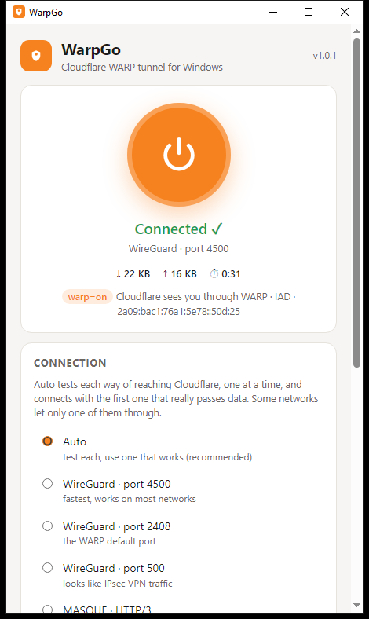

<p align="center">
  
</p>

<h1 align="center">WarpGo for Windows: free Cloudflare WARP client</h1>

<p align="center">
  <b>WarpGo</b> is a free, open-source <b>Cloudflare WARP client for Windows 10 and 11</b>.<br>
  One click sends your PC's traffic through Cloudflare's <b>1.1.1.1 WARP</b> network over <b>WireGuard</b> or <b>MASQUE (HTTP/3)</b>.<br>
  Its <b>Auto</b> mode finds the tunnel that actually works on school, campus, office and hotel Wi-Fi that blocks VPNs.
</p>

<p align="center">
  <a href="https://github.com/iknalos/WarpGo-Windows/releases/latest/download/WarpGo-Setup.exe"></a>
</p>

<p align="center">
  <a href="https://github.com/iknalos/WarpGo-Windows/releases/latest"></a>
  <a href="https://github.com/iknalos/WarpGo-Windows/releases"></a>
  <a href="https://github.com/iknalos/WarpGo-Windows/actions/workflows/build.yml"></a>
  <a href="LICENSE"></a>
  <a href="https://github.com/iknalos/WarpGo"></a>
</p>

<p align="center">
  
</p>

<p align="center">
  <b>Website:</b> <a href="https://iknalos.github.io/WarpGo/">iknalos.github.io/WarpGo</a> ·
  <b>Android app:</b> <a href="https://github.com/iknalos/WarpGo">github.com/iknalos/WarpGo</a>
</p>

---

## Why WarpGo

Some networks let a VPN connect and then quietly drop all of its traffic. A
campus firewall might allow the WireGuard handshake and block every data packet
after it. Another network blocks UDP entirely. Either way, a VPN app can show
"Connected" while nothing loads.

WarpGo checks that **data really comes back** before it says Connected. When
one way of reaching Cloudflare is blocked, it tries the next one.

| Option | What it is | Gets past |
|---|---|---|
| **WireGuard** · port 4500 / 2408 / 500 | the classic WARP tunnel over UDP | networks that block one UDP port |
| **MASQUE** · HTTP/3 | WARP inside QUIC on UDP 443, which looks like normal web traffic | firewalls that recognise WireGuard and drop it on every port |
| **MASQUE** · HTTP/2 | the same over TCP 443 | networks that block UDP altogether |

## Features

- **One-click Cloudflare WARP on Windows.** All traffic goes through Cloudflare, with DNS on `1.1.1.1` / `1.0.0.1`.
- **Auto mode.** Tests WireGuard on three ports, then MASQUE over HTTP/3 and HTTP/2, and connects with the first that passes real data. It remembers what worked on each network.
- **Honest status.** Shows *Connected ✓* only after traffic comes back through the tunnel, then asks Cloudflare to confirm `warp=on`.
- **Test every option.** Checks all five ways in under 30 seconds without connecting. Useful for working out what a network blocks.
- **Free, no sign-up.** WarpGo creates a free WARP account on your PC automatically. If a network blocks Cloudflare's sign-up page, it falls back to a built-in account.
- **Tray icon.** Stays running in the tray, can start with Windows, and can connect on launch.
- **Updates itself.** Installed copies download the next release, check its SHA-256 and install it.
- **No leftovers.** Routes and the network adapter are removed when you disconnect, and Windows' own default route is never touched.
- **Command line.** `--test`, `--connect`, `--headless` for scripts (see below).

## Download and install

1. Download **[WarpGo-Setup.exe](https://github.com/iknalos/WarpGo-Windows/releases/latest/download/WarpGo-Setup.exe)** (installer, recommended), or
   **[WarpGo-Portable.exe](https://github.com/iknalos/WarpGo-Windows/releases/latest/download/WarpGo-Portable.exe)** (a single exe, no install).
2. Run it. Windows asks for administrator rights, because creating a VPN network adapter needs them.
3. Click the power button.

> **"Windows protected your PC"?** The exe isn't code-signed yet, so SmartScreen
> warns about new downloads. Click **More info → Run anyway**. You can check the
> file against `SHA256SUMS.txt` on the [release page](https://github.com/iknalos/WarpGo-Windows/releases/latest).
> Everything is built from this repository by [GitHub Actions](.github/workflows/build.yml).

Requirements: Windows 10 or 11 (64-bit) and the Microsoft Edge WebView2 Runtime, which
Windows 11 and up-to-date Windows 10 already include.

To uninstall, use **Settings → Apps → WarpGo**. The portable exe can simply be deleted.

## How Auto works

Auto tries each option one at a time:

1. whatever worked last time on this network,
2. WireGuard on 4500, then 2408, then 500,
3. MASQUE over HTTP/3, then HTTP/2.

Each test builds a complete tunnel **in memory** and sends a DNS query to `1.1.1.1`
through it. A test passes only if the answer comes back. That catches the
firewalls that accept a handshake and then drop everything, which would
otherwise look like a working connection.

After connecting, WarpGo waits for real traffic before showing *Connected ✓*.
Then it fetches `https://www.cloudflare.com/cdn-cgi/trace` and shows Cloudflare's
own answer (`warp=on`, the data centre and your WARP IP).

## Command line

`WarpGo.exe` also runs from a terminal:

```text
WarpGo.exe --test                         test all five options, print the results (no admin needed)
WarpGo.exe --connect                      open the window and connect with Auto
WarpGo.exe --connect=masque-h3            connect with one option
WarpGo.exe --minimized                    start in the tray
WarpGo.exe --headless --connect=auto --for 1h --expect-warp https://www.cloudflare.com/cdn-cgi/trace
WarpGo.exe --version
```

Options: `auto`, `wireguard-4500`, `wireguard-2408`, `wireguard-500`, `masque-h3`, `masque-h2`.
You can also pass `--wg-account wgcf-profile.conf` and `--masque-account config.json` to use your own
[wgcf](https://github.com/ViRb3/wgcf) or [usque](https://github.com/Diniboy1123/usque) accounts.

## FAQ

**Is WarpGo free?**
Yes. WarpGo is free and open source (MIT), and it uses Cloudflare's free WARP service.

**Is this the official Cloudflare app?**
No. WarpGo is an independent, unofficial client. Cloudflare's own app is
[1.1.1.1 / WARP](https://one.one.one.one/). WarpGo talks to the same WARP network.

**Does WarpGo work on school or campus Wi-Fi?**
It was built for that. It was first written for a campus network that blocked
gaming traffic, and later used on one that dropped WireGuard data on every port.
MASQUE over HTTP/3 got through there. Use **Test every option** to see what your
network allows. Follow your network's rules.

**Does it change my DNS?**
While connected, Windows uses Cloudflare's `1.1.1.1` and `1.0.0.1` (plus their IPv6
addresses) through the tunnel. Everything goes back to normal when you disconnect.

**Does it hide my IP address or change my country?**
Websites see a Cloudflare IP instead of your network's, usually in or near your own
country. WARP is designed for privacy and reliability, not for appearing to be somewhere else.

**Why does it need administrator rights?**
Windows only allows administrators to create a virtual network adapter
([Wintun](https://www.wintun.net)) and change routes. Every VPN client needs this permission.

**Does WarpGo collect data?**
No. It connects only to Cloudflare (sign-up API and WARP servers) and to GitHub (update check).
Your WARP account lives in `%AppData%\WarpGo`.

**Is there a WARP+ / Zero Trust option?**
Not yet. WarpGo uses free consumer WARP accounts.

**Does it work on a phone?**
Yes: **[WarpGo for Android](https://github.com/iknalos/WarpGo)** has the same Auto mode.

## How it works

```
WarpGo.exe ─ window (WebView2) + tray
  └─ engine (Go)
       ├─ WireGuard ......... wireguard-go
       ├─ MASQUE ............ usque (CONNECT-IP over HTTP/3 or HTTP/2)
       └─ Wintun adapter "WarpGo"
            ├─ address from your WARP account, DNS 1.1.1.1 / 1.0.0.1, metric 0
            ├─ routes 0.0.0.0/1 + 128.0.0.0/1 (and ::/1 + 8000::/1)
            └─ a /32 route keeps the tunnel's own packets to Cloudflare on your Wi-Fi
```

The two half-routes beat Windows' default route without replacing it, so if
WarpGo ever crashes, your normal internet still works. The tunnel engine is the
same Go code as the [Android app](https://github.com/iknalos/WarpGo)'s.

Every push runs [build.yml](.github/workflows/build.yml) on a Windows runner:

1. `go vet` and unit tests
2. all five connection tests must pass real data
3. a real tunnel in **each** mode must reach Cloudflare with `warp=on`
4. a full-PC tunnel with Auto, then a check that no routes are left behind
5. the installer is built, installed, launched and uninstalled
6. release: `WarpGo-Setup.exe`, `WarpGo-Portable.exe`, `SHA256SUMS.txt`, `latest.json`

## Build from source

Requires Go 1.26 on Windows. No C compiler needed.

```powershell
git clone https://github.com/iknalos/WarpGo-Windows
cd WarpGo-Windows
go run ./tools/fetchwintun                 # official wintun.dll, checksum-verified
go install github.com/tc-hib/go-winres@v0.3.3
cd cmd/warpgo; go-winres make --in ../../winres/winres.json --arch amd64; cd ../..
go build -ldflags "-H windowsgui" -o WarpGo.exe ./cmd/warpgo
```

The installer is built with [Inno Setup 6](https://jrsoftware.org/isinfo.php): `iscc installer\WarpGo.iss`.

## Credits and license

WarpGo is MIT licensed. It is built on [wireguard-go](https://git.zx2c4.com/wireguard-go),
[wireguard-windows](https://git.zx2c4.com/wireguard-windows)' `winipcfg`,
[usque](https://github.com/Diniboy1123/usque), [quic-go](https://github.com/quic-go/quic-go),
[go-webview2](https://github.com/jchv/go-webview2) and [Wintun](https://www.wintun.net).
See [THIRD_PARTY_NOTICES.md](THIRD_PARTY_NOTICES.md).

*WarpGo is not affiliated with, endorsed by or sponsored by Cloudflare, Inc.
"Cloudflare" and "WARP" are trademarks of Cloudflare, Inc. WireGuard is a registered
trademark of Jason A. Donenfeld.*
